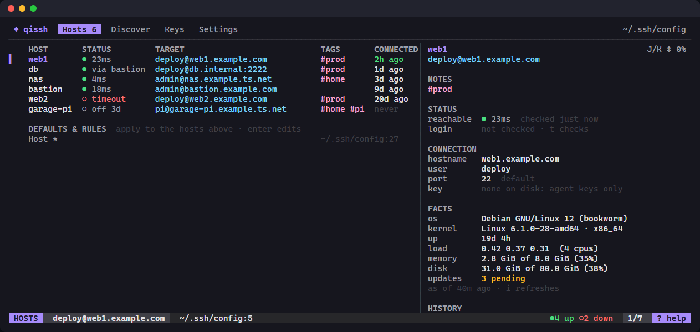

# QiSSH

*Qi, as in chi: the energy of ssh that flows between things.*

A terminal dashboard for the hosts in your `~/.ssh/config`. Pick one and you're connected. It also shows what ssh will actually use for each host and where in the file every value comes from.



- **See which hosts are up** at a glance, including through jump hosts and on your Tailscale tailnet, and check that key logins work.
- **Connect with a key press or a double-click**, in this terminal or a new zellij or Windows Terminal tab.
- **Add, edit and delete hosts** without opening the file. Comments, formatting and everything else in it are kept, every save is checked by ssh first, and the old file is backed up.
- **Manage keys**: make them, load them into the agent, and copy them to hosts (Linux, macOS and Windows hosts alike).
- **Find machines to add** from your tailnet and `known_hosts`.
- **Work across hosts**: run a command on many at once, start port forwards, fetch facts (OS, load, disk, pending updates), and find mistakes in your config.
- Works the same on Windows, macOS and Linux, with the keyboard or the mouse.

```
qs                # the dashboard
qs web1           # connect: an exact alias, or the only fuzzy match ("qs gar" → garage-pi)
qs -              # reconnect to the last host
qs ls             # list hosts (--json, --names)
qs check          # which hosts are up (--login also tries logging in)
qs doctor         # mistakes in your ssh config
qs add db deploy@db.internal:2222 -i ~/.ssh/id_deploy -J bastion
                  # add a host without opening the dashboard
```

QiSSH runs your own `ssh`, so the session is exactly what `ssh <alias>` gives you: agents, `ProxyJump`, `ControlMaster` and everything else in your config keep working. Your ssh config stays the source of truth.

## Install

QiSSH needs OpenSSH's `ssh` on your PATH, which is built into Windows 10 and later, macOS and most Linux distributions.

Download the archive for your system from [Releases](https://github.com/bferg314/qissh/releases) and put `qissh` (`qissh.exe` on Windows) somewhere on your PATH. There are builds for Linux, macOS and Windows, on x86-64 and ARM.

Or, with Go 1.26 or newer:

```sh
go install github.com/bferg314/qissh/cmd/qissh@latest
```

This puts `qissh` in `$(go env GOPATH)/bin` (`~/go/bin`, or `%USERPROFILE%\go\bin` on Windows). Make sure that folder is on your PATH. `qissh --version` says which version you have.

### The `qs` command

The shell integration defines `qs` and tab-completes your host aliases. Add the line for your shell to its startup file:

```sh
eval "$(qissh init bash)"                                # ~/.bashrc
eval "$(qissh init zsh)"                                 # ~/.zshrc
qissh init fish | source                                 # ~/.config/fish/config.fish
Invoke-Expression (& qissh init powershell | Out-String)  # $PROFILE
```

If `qs` clashes with something, set `alias_name` in the config and the function gets that name instead.

## The Hosts tab

Every host in your ssh config, including files pulled in with `Include`, with where it connects to (as `ssh -G` resolves it) and when you last connected from QiSSH. Hosts you use most are listed first.

- `enter` connects. `/` filters by alias or hostname, and `enter` in the filter connects straight away once only one host is left.
- `space` selects several hosts and `enter` opens one tab each (inside zellij or Windows Terminal). `a` selects all and `esc` clears the selection.
- `m` lists everything you can do to the host, with each action's key.
- `y` copies the ssh command, alias, hostname, `user@hostname` or the host's whole block.
- `n` adds a host and `e` edits the selected one: alias, HostName, User, Port, IdentityFile and ProxyJump, plus tags, a web page and notes. The edit form also has **Delete host**, which asks first.
- `E` opens the file that defines the host in your editor, at the host's line. QiSSH notices when the file changes, whether you edit it from here or anywhere else, and reloads.
- `C` copies one of your public keys to the host, or to every selected host (see [The Keys tab](#the-keys-tab)).
- `w` opens the host's web page.
- `x` runs a command on the host, or on every selected host, `i` fetches its facts and `T` starts and stops its tunnels (see below).
- `*` pins a host to the top, `h` hides one, `H` shows hidden hosts.
- `s` sorts by most used, name or file order. `r` reloads.
- Tools run with their own key: `o` opens the host in VS Code (Remote - SSH), `f` starts `sftp`, and `M` starts `mosh` when it's installed.

**Tags, web page and notes** are QiSSH's own and are kept in its `config.toml`, never in your ssh config. Tags show in a TAGS column and in the filter: `/home` finds hosts tagged `home` as well as matching names, and `/#home` finds only tagged ones. The web page (`http://nas:5000`, or just `nas:5000`) opens with `w`, and notes show in the detail pane. Renaming a host keeps them; deleting it drops them.

### Mouse

Click a tab to switch to it and a row to move to it, on every tab. Double-click is `enter` (connect, add a discovered machine, open a key's menu) and right-click is `m`. Clicking the space left of a host or machine selects it, like `space`. The HOST, STATUS and CONNECTED headings sort by name, status and most used. The wheel moves through lists and scrolls the detail pane, help, the doctor and command output under the pointer.

In Settings, a click moves to a setting and a click on its checkbox (or `▸`) changes it. In menus a click runs the action, in forms it moves to the field or presses the button, and in the doctor it picks a finding (double-click opens its line). `? help` and `!N to fix` in the status bar open help and the doctor. While a menu, help or the doctor is open, a click outside it closes it; a click outside a form does nothing, so what you typed isn't lost.

While QiSSH has the mouse, your terminal's own text selection needs Shift held (Option in macOS Terminal and iTerm2). To turn the mouse off, untick **Mouse** in Settings or set `mouse = false`.

### How QiSSH edits your config

Edits change as little as possible. A changed value rewrites only its own line, in the style it was written: `hostname` stays lowercase, `user=deploy` keeps its `=`, and trailing comments stay. A new option goes at the end of the host's block with the block's indent. Other options in the block, comments, blank lines and the rest of the file are untouched. New hosts go before the first `Host *` (or other pattern) or `Match` block, because ssh uses the first value it finds and a host after `Host *` would lose to its defaults. Deleting a host removes its block and the comment lines directly above it. If the block also names other hosts (`Host nas storage`), only that name is removed.

Every save is checked first. QiSSH writes the new file next to the old one and asks `ssh -F <new file> -G` to read it. If ssh rejects it, nothing is written and you see ssh's message. It then backs up the old file, to `backups` in QiSSH's cache folder (the last 10 are kept) and to `config.qs-bak` beside it, swaps the new file in and checks it once more. If the file changed on disk while you were editing, the save is refused rather than overwriting that change.

`qs add <alias> <user@host[:port]> [-i key] [-J jump]` adds a host from the shell the same way, with the same checks, placement and backups as `n`. Write an IPv6 address with a port in brackets: `root@[fe80::1]:2222`.

### Is it up?

The **STATUS** column shows each host as `● 12ms` (up, with the time to connect), `○ refused` / `○ timeout` / `○ no dns` (down), or `◌` while it's being checked. QiSSH checks every host when it starts and every 60 seconds while it's open (change that under **Check every** in Settings). It never logs in to do this: it only opens a TCP connection to the ssh port and closes it again.

- **Tailscale:** if `tailscale` is installed and connected, hosts whose HostName is a tailnet machine (by MagicDNS name, short name or Tailscale IP) use Tailscale's view, so a machine that's off shows `○ off 3d` (last seen 3 days ago) rather than timing out. The detail pane adds its OS.
- **Jump hosts:** a host reached through `ProxyJump` can't be checked directly, so it shows its first jump host's state as `● via bastion`.
- **Login check (`t`):** tries to log in to the selected host, or every selected host, with keys only and a short timeout, and runs `exit 0`. It never stops at a password or passphrase prompt. The result goes in the detail pane: login works, needs a password or passphrase, host key not known yet, host key changed, refused, timed out, or doesn't resolve.
- **Host keys:** when the login check finds a host key that changed (`▲ host key!`) or that isn't known yet, it shows the fingerprint `known_hosts` has next to the one the host presents now, with a warning if the key changed. `y` trusts the new key: `ssh-keygen -R` removes the old one (keeping `known_hosts.old`) and exactly the key you were shown is added. To see the key, QiSSH connects using a throwaway known_hosts file, so nothing is trusted until you say so.

`s` can also sort by status, with hosts that are up first (fastest first). The status bar counts how many hosts are up and down.

From the shell, `qs check` prints the same status for every host (or the ones you name) and exits with status 1 if any are down. `qs check --login` adds the login check.

`Host *`, other pattern blocks and `Match` blocks are listed under **Defaults & rules** at the bottom. `enter` on one opens it in your editor.

### Detail pane

On terminals at least 100 columns wide, a pane beside the list shows the selected host's hostname, user, port, key, jump host and port forwards. Any value that doesn't come from the host's own block says where it does come from, such as `from Host *`, `from line 27` (another block for the same host) or `default` (ssh's built-in value). Below that are the host's tunnels and facts, your connection history, the file and line that define the host, and the block as written. `d` hides the pane, or on narrower terminals shows it full screen. `J`/`K` scroll it.

Press `?` for every key. `tab` and `←`/`→` (or `1`–`4`) switch tabs.

### Running a command on many hosts

`x` asks for a command and runs it on every selected host at once (or the host under the cursor). Then it shows each host's output with its exit status, failures first. `r` runs it again, `e` changes the command, and `y` copies all the output. ssh runs without a terminal and with keys only, so a command that prompts (such as `sudo` asking for a password) fails rather than hanging. Each host gets two minutes.

In the prompt, `ctrl+s` saves the command as a snippet, `↑`/`↓` pick a saved snippet, and `ctrl+d` deletes one. Snippets are kept in `config.toml`.

### Facts

`i` asks the host (or every selected host) about itself with one ssh command: OS, kernel and architecture, uptime, load, memory, disk use of `/` (or `C:`), pending package updates and whether a reboot is needed. Updates are counted from what the package manager already knows (`apt-get -s`, `dnf --cacheonly`, `pacman -Qu`), so nothing is downloaded and nothing needs root. Windows hosts, as Tailscale reports them, are asked with PowerShell. Facts appear in the detail pane and are kept in `facts.json` in the cache folder, so you see the last ones (and how old they are) next time.

### Tunnels

`T` lists the host's saved tunnels: press a tunnel's number to start it, and press it again to stop it. `n` starts a new one. Write it the way you think of it:

| You type | ssh gets |
|---|---|
| `5432` | `-L 5432:localhost:5432`: the host's port 5432 on `localhost:5432` here |
| `8080:80` | `-L 8080:localhost:80` |
| `8080:db:5432` | `-L 8080:db:5432`: a machine the host can reach |
| `R 9000:localhost:3000` | `-R`: your port 3000 on the host's port 9000 |
| `D 1080` | `-D 1080`: a SOCKS proxy through the host |

`enter` starts it, and `ctrl+s` starts it and saves it to the host, in `config.toml`. Each tunnel is a background `ssh -N` that uses keys only, with `ExitOnForwardFailure`, so a port already in use or a failed login shows as an error rather than a tunnel that does nothing. The status bar counts running tunnels, and the detail pane marks them with `●`. They stop when QiSSH exits.

### Config doctor

`!` (or `qs doctor`) lists mistakes in your ssh config. The status bar shows how many need fixing.

- **Problems** (ssh fails or refuses):
  - an `IdentityFile` that doesn't exist;
  - on Linux and macOS, a config file that others can write to, or a private key that others can read.
- **Warnings** (probably not what you meant):
  - an option that's ignored because an earlier block, usually `Host *` at the top, sets it first;
  - a `ProxyJump` through a name that isn't one of your hosts;
  - an `Include` that can't be read.
- **Notes**: a host defined in more than one block, or a key without a passphrase.

Each finding says why it matters and how to fix it. `enter` opens the line in your editor and `y` copies the fix.

## The Discover tab

Machines you could add but haven't: the machines on your tailnet (when Tailscale is installed and connected) and the hosts in `~/.ssh/known_hosts` that no Host block points at, meaning ones you've connected to by name or address. A tailnet machine counts as configured when a host's HostName is its MagicDNS name, short name or Tailscale IP, or a host's alias is its short name.

To keep the list useful, QiSSH leaves some entries out:

- hashed `known_hosts` entries, which can't be read;
- git forges such as `github.com`;
- names on your tailnet's domain that are no longer on the tailnet;
- phones and tablets you've never connected to (`H` shows these).

- `enter` opens the new-host form filled in: alias from the machine's name, HostName, your usual `User`, and the tag `tailnet`. Save is already selected, so `enter` again adds it. From the Hosts tab, that's `2`, `enter`, `enter`. QiSSH then switches to Hosts with the new host selected.
- `space` selects several machines (`a` selects all) and `enter` adds them all in one save, after showing what each becomes. Clashing aliases get `-2`, and a bare address becomes `10-0-0-5`.
- `w` opens the machine in Tailscale's admin console, and `y` copies its address.
- `h` hides a machine (saved in `config.toml`), and `H` shows hidden ones. `/` filters by name, address or OS, and `r` reloads.

## The Keys tab

Every key pair in `~/.ssh`: its type and size, fingerprint and comment, whether it has a passphrase (**⚠ none** if not), whether the agent has it loaded, and which hosts use it (by `IdentityFile`, or ssh's default key names). QiSSH reads the public key files and only the header of each private key, to see whether it's encrypted.

- `n` makes a new key with `ssh-keygen` (ed25519 unless you pick ecdsa or rsa), named so it doesn't overwrite one you have. ssh-keygen asks for the passphrase itself.
- `A` adds the key to the agent with `ssh-add`, which asks for the passphrase. If there's no agent, the tab says why and how to start one. On Windows that depends on which ssh is first on your PATH: Windows' own uses the `ssh-agent` service (which is disabled until you enable it), while Git's uses `SSH_AUTH_SOCK` and can't reach that service.
- `C` copies the public key to hosts: pick them on the Hosts tab (`space` selects, `C` copies to the selected hosts or the one under the cursor, `esc` cancels).
- `y` copies the public key to the clipboard. `enter` lists everything you can do to the key.

### Copying a key to a host

There's no `ssh-copy-id` on Windows, so QiSSH does the same job itself. Before anything runs it shows where the key will go on each host. Then it hands the terminal to ssh, one host at a time, so ssh can ask for passwords. The key is added only if it isn't there already (matched by the key itself, not the comment).

- **Linux, macOS, BSD:** appended to `~/.ssh/authorized_keys`, creating the folder and file readable only by you if they don't exist.
- **Windows (OpenSSH Server):** members of Administrators log in with `C:\ProgramData\ssh\administrators_authorized_keys`, so the key goes there and that file is limited to Administrators and SYSTEM, as sshd requires. Everyone else uses `~\.ssh\authorized_keys`. QiSSH treats a host as Windows when Tailscale says it runs Windows; `w` in the confirmation changes that.

Afterwards each host's login is checked (as with `t`), so you can see the key works. If a host failed, QiSSH waits for `enter` before returning so you can read why.

## Where sessions open

The `connect_mode` setting (change it on the Settings tab) decides where a session opens:

| Mode | |
|---|---|
| `auto` (default) | A new zellij tab when QiSSH runs inside zellij, a new Windows Terminal tab inside Windows Terminal, otherwise this terminal |
| `in_place` | This terminal. QiSSH quits and ssh takes over, unless **Stay open** is on, in which case you come back to the list when the session ends |
| `zellij` / `wt` | Always a new zellij / Windows Terminal tab |
| `shell` | QiSSH quits and `qs` runs `ssh <alias>` in your shell, so it lands in your shell history (needs the shell integration) |

`qs <host>` from the command line always connects in the current terminal.

## Config

On first run QiSSH writes `config.toml` to your OS config folder (`%AppData%\qissh` on Windows, `~/Library/Application Support/qissh` on macOS, `~/.config/qissh` on Linux) and turns on every tool it finds on your PATH. Folders from before the rename (`quick-ssh`) are moved over the first time it runs.

```toml
ssh_config = "~/.ssh/config"   # another file is passed to ssh with -F
alias_name = "qs"
connect_mode = "auto"           # auto | in_place | zellij | wt | shell
stay_open = false
check_interval = "60s"          # "0" checks only at start and on r
check_timeout = "2s"
tailscale = true
mouse = true                    # clicks and the wheel; Shift+drag still selects text
pinned = ["nas"]                # set with * on the Hosts tab
hidden = []                     # set with h

[hosts.nas]                     # set in the host form (e)
tags = ["home", "storage"]
notes = "RAID 5, 4 × 8 TB; on the UPS"
web = "http://nas:5000"

[[hosts.nas.tunnels]]           # saved with ctrl+s in a new tunnel (T, n)
name = "grafana"
spec = "L 3000:localhost:3000"

[[snippets]]                    # saved with ctrl+s in the run prompt (x)
cmd = "df -h /"

[[tools]]
name = "VS Code"
cmd = "code"
args = ["--remote", "ssh-remote+{alias}", "{home}"]
key = "o"
mode = "detach"                 # starts in the background
enabled = true

[[tools]]
name = "SFTP"
cmd = "sftp"
args = ["{alias}"]
key = "f"
mode = "terminal"               # suspends qissh until the tool exits
enabled = true
```

Tool arguments can use `{alias}`, `{hostname}`, `{user}`, `{port}` and `{home}` (`/home/<user>`, or `/root`). Inside zellij, terminal tools open in a new tab unless they set `in_place = true`.

Connection history (`history.json`) and host facts (`facts.json`) are kept in your OS cache folder.

## Development

```
go build ./cmd/qissh
go test ./...
```

[PLAN.md](PLAN.md) is the design QiSSH is built from, with the decisions made along the way. The screenshot above is drawn from a made-up set of hosts by `QS_SCREENSHOT=$PWD/docs/screenshot.html go test ./internal/ui -run TestScreenshot`; open the HTML file it writes in a browser to capture it.

## License

MIT. See [LICENSE](LICENSE).
